# MapControl Arayüz Haritası (UI-Map)

Bu belge, MapControl otomotiv bilgi-eğlence (IVI / HMI) sisteminin tam ekran, sekme, bileşen ve gezinme mimarisini listeler.

---

## 1. Genel Ekran Düzeni ve Yerleşim Mimarisi

MapControl iki temel ekran oryantasyonunu destekler:
1. **Yatay (Landscape / Standart Otomotiv 16:9 & Ultra-Wide):**
   * **Sol Panel (`SideRail`):** Ekran genişliğine göre dinamik ölçeklenir; minimum `270dp`, maksimum `468dp` (önceki boyutlara göre **%10 daraltılmıştır**). Üst kısmında canlı durum rozetleri (`StatusWidgetsView`), altında kaydırılabilir menü öğeleri yer alır. Launcher modunda gizlenebilir.
   * **Ana İçerik (`mainContent`):** Kalan ekran genişliğini kaplar. Dikey yönde `Header / TopBar` ve `tabContentArea` bileşenlerini barındırır.
   * **Header Menü Konumu (`header_menu_bottom`):** Ayarlardan seçilebilir:
     * **Yukarıda (Varsayılan):** Header ekranın üstündedir; içerik altında yer alır. Ayırıcı çizgi (`topBarDivider`) header'ın altındadır.
     * **Aşağıda:** Header ekranın altındadır; içerik üstünde yer alır. Ayırıcı çizgi (`topBarDivider`) header'ın üstündedir.
     * *Rerender politikası:* Konum değişimi sadece ViewGroup hiyerarşisinde `removeView`/`addView` ile gerçekleşir; Activity, SurfaceView veya sekme içerikleri yeniden oluşturulmaz (0 gecikme / 0 flicker).
2. **Dikey (Portrait / 9:16):**
   * Üstte yatay kaydırılan kompakt menü çubuğu, altında tam genişlikte içerik.

---

## 2. Gezinme Akış Şeması (Navigation Flow)

```mermaid
graph TD
    Launcher["Tab 10: Launcher Dashboard<br/>(3D Araç, Hızlı Kısayollar, Saat & Durum)"]
    
    subgraph "Ana Menü (SideRail / Hızlı Erişim)"
        Wifi["Tab 0: Wi-Fi"]
        Apps["Tab 1: Uygulamalar"]
        Aktar["Tab 2: Aktar (Telefondan Yönet)"]
        Welcome["Tab 4: Karşılama Sesi"]
        Equalizer["Tab 5: Ses Ayarları"]
        DriveMode["Tab 6: Sürüş Hafızası"]
        Automation["Tab 7: Otomasyon"]
        FaceRec["Tab 8: Yüz Tanıma (DMS)"]
        Cam360["Tab 9: Kamera 360"]
        Split["Tab 11: Bölünmüş Ekran"]
        Projection["Tab 12: Gösterge Ekranı"]
        VehicleInfo["Tab 13: Araç Bilgileri"]
        Settings["Tab 14: Ayarlar"]
        Log["Tab 15: Sistem Günlüğü"]
    end

    subgraph "Kamera 360 İç İçe Sayfaları (Nested Pages)"
        CamMenu["Kamera 360 Ana Menü"]
        CamPreview["Canlı Önizleme (4 Açı)"]
        CamRecord["USB Manuel Kayıt"]
        CamAuto["Araç İçi Otomatik Kayıt"]
        CamViewer["Kayıt Oynatıcı / Klipler"]
    end

    Launcher -->|Sekme Seçimi| Wifi
    Launcher -->|Sekme Seçimi| Apps
    Launcher -->|Sekme Seçimi| Aktar
    Launcher -->|Sekme Seçimi| DriveMode
    Launcher -->|Sekme Seçimi| Cam360
    Launcher -->|Sekme Seçimi| Settings

    SideRail -->|Doğrudan Geçiş| Wifi
    SideRail -->|Doğrudan Geçiş| Apps
    SideRail -->|Doğrudan Geçiş| Aktar
    SideRail -->|Doğrudan Geçiş| DriveMode
    SideRail -->|Doğrudan Geçiş| Cam360
    SideRail -->|Doğrudan Geçiş| Settings

    Cam360 --> CamMenu
    CamMenu -->|Canlı İzle| CamPreview
    CamMenu -->|USB Kayıt| CamRecord
    CamMenu -->|Otomatik Kayıt| CamAuto
    CamMenu -->|Kayıtları Gör| CamViewer

    CamPreview -->|Header Geri Butonu| CamMenu
    CamRecord -->|Header Geri Butonu| CamMenu
    CamAuto -->|Header Geri Butonu| CamMenu
    CamViewer -->|Header Geri Butonu| CamMenu
    CamMenu -->|Header Geri / Home| Launcher
```

---

## 3. Sekme Dizini ve Sayfa Detayları

| Sekme No | Kimlik / Ad (TR) | Ad (EN) | Builder Sınıfı | İç İçe Sayfa (Nested) | Detay Dokümanı |
|:---:|---|---|---|:---:|---|
| **0** | Wi-Fi | Wi-Fi | `WifiTabBuilder` | Yok | [00-wifi.md](pages/00-wifi.md) |
| **1** | Uygulamalar | Apps | `AppsTabBuilder` | Yok | [01-apps.md](pages/01-apps.md) |
| **2** | **Aktar** *(Eski: Telefondan Yönet)* | **Transfer** *(Former: Phone Access)* | `FileUploadTabBuilder` / `WebTabBuilder` | Yok | [02-aktar.md](pages/02-aktar.md) |
| **3** | Profil *(Deneysel / Gizli)* | Profile | `ProfileTabBuilder` | Yok | - |
| **4** | Karşılama | Welcome | `WelcomeSoundTabBuilder` | Yok | [04-welcome.md](pages/04-welcome.md) |
| **5** | Ses Ayarları | Sound Settings | `EqualizerTabBuilder` | Yok | [05-equalizer.md](pages/05-equalizer.md) |
| **6** | **Sürüş Hafızası** *(Eski: Sürüş Modu)* | **Drive Memory** | `DriveModeTabBuilder` + `AssistTabBuilder` | Yok | [06-surus-hafizasi.md](pages/06-surus-hafizasi.md) |
| **7** | Otomasyon | Automation | `ClimateAutomationTabBuilder` | Yok | [07-automation.md](pages/07-automation.md) |
| **8** | Yüz Tanıma | Face Recognition | `DmsFaceRecognitionTabBuilder` | Harici Activity (`DmsFaceProfileActivity`) | [08-face-recognition.md](pages/08-face-recognition.md) |
| **9** | **Kamera 360** | **Camera 360** | `Camera360TabBuilder` | **Var (5 Mod: Menu, Preview, Record, Auto, Viewer)** | [09-camera-360.md](pages/09-camera-360.md) |
| **10** | Launcher Dashboard | Launcher Dashboard | `LauncherTabBuilder` + `LauncherDashboardBuilder` | Yok | [10-launcher.md](pages/10-launcher.md) |
| **11** | Bölünmüş Ekran | Split Screen | `SplitScreenTabBuilder` | Yok | [11-split-screen.md](pages/11-split-screen.md) |
| **12** | Gösterge Ekranı | Instrument Display | `ProjectionTabBuilder` | Diyalog / Uygulama Seçici | [12-projection.md](pages/12-projection.md) |
| **13** | Araç Bilgileri | Vehicle Information | `VehicleInfoTabBuilder` | Mühendislik Menüsü | [13-vehicle-info.md](pages/13-vehicle-info.md) |
| **14** | **Ayarlar** | **Settings** | `SettingsTabBuilder` | Gelişmiş Bilgi / İzinler | [14-settings.md](pages/14-settings.md) |
| **15** | Sistem Günlüğü | System Log | `LogTabBuilder` | Yok (Gizli Başlık Tıklaması) | [15-log.md](pages/15-log.md) |
| **-** | **Genel Bileşenler (Chrome)** | **Global Chrome** | `TopBarBuilder`, `SideRailBuilder`, `FloatingBackButtonManager` | Üst / Alt / Sol Şerit | [global-chrome.md](pages/global-chrome.md) |

---

## 4. Özel Gezinme ve Başlık Kuralları

1. **Header Sabit Geri Butonu:**
   * Kamera 360 gibi hiyerarşik veya iç içe sayfaların bulunduğu bölümlerde, Header başlığının hemen solunda sabit bir geri düğmesi (`header_back_button`, 44x44 dp) konumlandırılır.
   * Alt sayfadayken (örn. Kamera 360 klip oynatıcı veya canlı önizleme), bu düğmeye basıldığında doğrudan ilgili bölümün ana menüsüne dönülür (`enterMenu()`).
   * Ana menüdeyken veya diğer sekmelerdeyken tıklandığında Launcher ana sayfasına dönüş sağlanır.
   * Android donanımsal/sistem geri düğmesi (`onBackPressed()`) de aynı hiyerarşik sırayı izler: önce alt sayfadan çıkar, ardından Launcher'a döner.

2. **Header Konumu:**
   * `Ayarlar > Header Menü Konumu` üzerinden "Yukarıda" veya "Aşağıda" olarak yapılandırılır. Tercih `header_menu_bottom` anahtarıyla kaydedilir ve uygulama genelinde sıfır gecikmeyle uygulanır.
